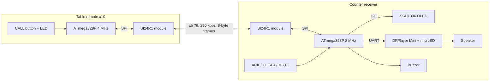

# System architecture



## Decisions (all reversible, all documented)

| Question | Decision | Why |
|---|---|---|
| MCU | ATmega328P-AU on **both** boards | one toolchain, one radio driver; the Blue Pill/STM8 would add a second toolchain for no gain (the receiver needs ~13 KB flash and ~1 KB RAM) |
| Remote clock | 4 MHz (8 MHz RC, CKDIV8 fuse, firmware switches to /2) | ATmega328P is only specified for 4 MHz below 2.7 V; a coin cell sags below that |
| Receiver clock | 8 MHz crystal at 3.3 V | accurate baud for the DFPlayer UART; 3.3 V logic matches radio, OLED, DFPlayer |
| Remote supply | battery **direct** (no regulator), CR2450 or 2xAAA | radio runs 1.9-3.6 V, MCU 1.8 V at 4 MHz; a regulator would add quiescent current and drop-out |
| Radio driver | own register-level driver ([why](radio-driver-choice.md)) | RF24 power encoding differs; abstraction layer kept |
| Reverse channel | separate application packets, not ACK payloads | an ACK payload must be loaded before the packet arrives, so it cannot prove the receiver recorded *this* call |
| Served notice | polling by the remote ([protocol](wireless-protocol.md)) | a battery remote cannot listen continuously |
| Audio | prerecorded files in `/MP3/NNNN.mp3` via DFPlayer | no TTS on the AVR |
| Display | page-at-a-time rendering, 128-byte buffer | 2 KB RAM; no 1 KB framebuffer |
| Persistence | wear-levelled EEPROM ring, written only on table change | about 20 slots x 43 bytes; each save writes only bytes that changed |

## Firmware layout

```
firmware/
  common/            Arduino library "BellCommon" (shared by both sketches)
    src/bell_protocol  wire format, CRC, addresses          (pure C, host-tested)
    src/call_table     receiver pending-call table           (pure C, host-tested)
    src/rx_core        receiver decision logic               (pure C, host-tested)
    src/remote_fsm     remote retry/backoff engine           (pure C, host-tested)
    src/persist_log    EEPROM ring log                       (pure C, host-tested)
    src/radio_driver.h + radio_si24r1.cpp   radio abstraction + Si24R1 driver (AVR only)
  remote/            sketch: config, button_handler, led_status, power_manager, call_manager, persistent_state
  receiver/          sketch: config, ssd1306 + oled_ui, audio_player, alert_buzzer, button_handler, persistent_state
tests/protocol-tests host tests (476 checks) + 10-remote lossy-channel simulation
tools/               build_firmware.py, battery_calc.py
hardware/            reference KiCad boards, BOMs, EasyEDA data pack, diagrams
```

Build-time configuration (compile flags or edit `config.h`): `TABLE_ID`, `BELL_CHANNEL`, `BELL_RATE`, `BELL_TX_POWER`,
retry settings, `AUDIO_VOLUME`, `REPEAT_INTERVAL_S`, `REPEAT_MAX`, sleep/battery thresholds. Invalid values fail the build
(`static_assert`/`#error`): table id outside 1..10, channel above 83, volume above 30, PCB build with the wrong clock.

## Receiver loop (no long blocking)

1. drain up to 3 radio packets, decide with `rx_core_handle`, reply over the air (one bounded radio transmit, about 8 ms worst case)
2. buttons (debounced; CLEAR needs a 2 s hold)
3. repeat timers (default every 30 s, 5 repeats, then the call stays on the OLED only)
4. audio queue (non-blocking; one 10-byte serial frame per track), buzzer pattern, OLED (one page per pass, about 4 ms)
5. EEPROM save **after** the reply, watchdog reset (PCB build)

Known blocking points, all short and bounded: one radio reply, one EEPROM save (up to about 50 ms), one OLED page, and
`SoftwareSerial` writes on the Uno prototype (about 1 ms per byte; the PCB uses the hardware UART).
The radio's 3-deep RX FIFO plus the remotes' retries cover those windows; this has **not** been measured on hardware.
