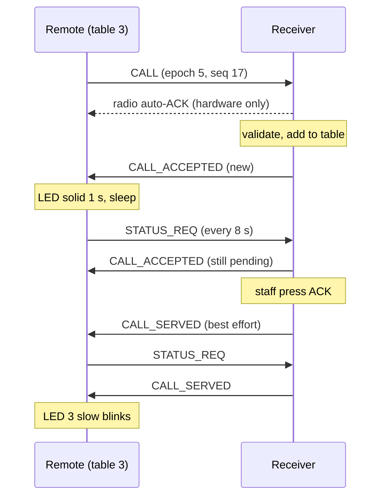

# Wireless protocol (v1)

Implemented in [`firmware/common/src/bell_protocol.*`](../firmware/common/src/bell_protocol.h),
[`call_table.*`](../firmware/common/src/call_table.h), [`remote_fsm.*`](../firmware/common/src/remote_fsm.h) and
[`rx_core.*`](../firmware/common/src/rx_core.h). The logic is pure C and is exercised by
[`tests/protocol-tests`](../tests/protocol-tests) (476 checks, see the test plan for what that does and does not prove).

## Two kinds of acknowledgement (do not confuse them)

| Level | Who sends it | What it proves |
|---|---|---|
| Radio auto-ACK | the SI24R1 hardware of the receiver, automatically | the receiver **radio** heard a frame with a valid CRC. Nothing else. |
| Application reply (`CALL_ACCEPTED`) | receiver **firmware**, as a separate packet | the receiver validated the packet **and recorded it in the pending-call table**. |

A remote treats a call as accepted only after a validated application reply that matches its
`(table, epoch, seq)`. `rf_sent(..., hw_ok)` only decides whether to listen for that reply; it never ends the call.

## Radio parameters

| Item | Value | Notes |
|---|---|---|
| Channel | 76 (2476 MHz) | above Wi-Fi channels 1/6/11, inside 2400-2483.5 MHz. Compile-time check rejects channels > 83. Survey your site: a Wi-Fi channel 13 AP overlaps it. |
| Air rate | 250 kbps | best sensitivity (-96 dBm); frame airtime about 0.55 ms. 1 and 2 Mbps are selectable in `config.h`. |
| TX power | 0 dBm | datasheet: 12 mA. `RF_PWR` is a 3-bit field on Si24R1 (not the nRF24 encoding). |
| Payload | static 8 bytes | no dynamic payload, no ACK payload. |
| CRC | 2 bytes | hardware CRC, enabled. |
| Hardware retries | 3 x 1000 us | `SETUP_RETR = 0x33`. ARD must exceed the ACK airtime at 250 kbps. |
| Address width | 5 bytes | |

### Addresses (5 bytes, MSByte first as written; the driver sends them LSByte first)

| Node | Address | Pipe used |
|---|---|---|
| Receiver | `REST1` | receiver listens on **pipe 1**; every remote transmits to it |
| Remote n | `TAB` + two ASCII digits: `TAB01` ... `TAB10` | the remote listens on its own **pipe 1** for the reply; the receiver transmits to it |

For hardware auto-ACK the transmitter sets `RX_ADDR_P0` equal to its `TX_ADDR`; `radio_send()` does this on every
transmit, and `radio_listen()` re-enables pipe 1 afterwards. Every address is distinct (checked by `test_protocol`).

## Packet layout (8 bytes, fixed)

| Byte | Field | Meaning |
|---|---|---|
| 0 | `ver_type` | high nibble = protocol version (1), low nibble = message type |
| 1 | `table` | 1..10 |
| 2 | `seq` | call sequence number. **Every retry of one press uses the same `seq`.** Wraps 255 -> 0. |
| 3 | `epoch` | per-boot counter of the remote (EEPROM). `(epoch, seq)` identifies a call. |
| 4 | `status` | depends on type, see below |
| 5 | `battery` | remote supply in units of 20 mV (0 = unknown); remote -> receiver only |
| 6 | `flags` | bit 0 = low battery |
| 7 | `crc8` | CRC-8, polynomial 0x07, init 0, over bytes 0..6 (check value for "123456789" = 0xF4) |

Byte order: every field is one byte, so there is no multi-byte endianness. Unknown version / type / table or a CRC mismatch
is dropped silently (counted in `g_bad_count`).

### Message types

| Type | Value | Direction | `status` byte |
|---|---|---|---|
| `CALL` | 1 | remote -> receiver | 0 |
| `CALL_ACCEPTED` | 2 | receiver -> remote | 0 new, 1 duplicate (already pending), 2 still pending (reply to `STATUS_REQ`) |
| `CALL_SERVED` | 3 | receiver -> remote | 0 |
| `ERROR` | 4 | receiver -> remote | 1 bad table, 2 unknown call (reply to `STATUS_REQ` the receiver has no record of) |
| `STATUS_REQ` | 5 | remote -> receiver | 0 ("is my call still pending?") |

A `HEARTBEAT` message was deliberately **not** added: the remote already reports battery in every `CALL` and `STATUS_REQ`.

## Receiver rules (`rx_core_handle`)

| Input | Table state | Result |
|---|---|---|
| `CALL` | none / served | **new pending entry**, announce, reply `ACCEPTED(NEW)` |
| `CALL` same `(epoch,seq)` | pending | **no new entry**, reply `ACCEPTED(DUPLICATE)` (this is the lost-reply case) |
| `CALL` same `(epoch,seq)` | served | no new entry, reply `SERVED` |
| `CALL` different `(epoch,seq)` | pending | keeps its queue position, re-announce, reply `ACCEPTED(NEW)` |
| `STATUS_REQ` | pending / served / unknown | `ACCEPTED(STILL_PENDING)` / `SERVED` / `ERROR(UNKNOWN_CALL)` |

* **One slot per table.** One remote cannot occupy more than one queue entry, so it cannot starve the others (tested: 300 presses
  from one table leave 3 entries in a 3-table queue). Display and ACK order is FIFO by first arrival.
* **Fairness at the radio:** the receiver drains at most 3 packets (the RX FIFO depth) per loop pass in arrival order, then
  services buttons, audio and display before reading again.
* **Restart of a remote:** `epoch` changes on every boot, so a restarted remote that reuses `seq` 0 is a new call, not a duplicate.
  `seq` rollover is harmless because only equality with the one stored call per table is compared. A repeated
  `(epoch, seq)` pair would need the remote to reboot exactly 256 times between two presses *and* collide on `seq`; not guarded further.
* **Receiver restart:** the table is saved to EEPROM after each change (wear-levelled ring, `persist_log`). The reply is sent
  **first** and the save follows (about 10-50 ms), so a power cut inside that window can lose a call the remote believes accepted.
  That gap is closed by the remote's `STATUS_REQ` poll: the receiver answers `UNKNOWN_CALL` and the remote re-sends the same `CALL`.
  With polling disabled the window remains. Restored pending calls are announced once at boot.

## Remote behaviour (`remote_fsm`)

Defaults (`firmware/remote/config.h`): 8 transmissions per press, 40 ms reply timeout after the radio ACK, backoff
`60 ms + pseudo-random 0..119 ms`, time arithmetic wrap-safe (`(int32_t)(now - deadline) >= 0`). If the radio ACK is **not** heard
the remote skips the reply wait and goes straight to backoff. Worst case about 2.2 s before the failure indication
(5 rapid LED flashes).

Collision handling: simultaneous presses collide, hardware retries (ARD 1 ms x 3) fail together, and the per-remote
random backoff (seeded from `micros()` and the table id) separates the application retries. The simulation
(`test_system_sim`, scenario A) forces 10 remotes within 3 ms and all 10 still get accepted.

### Served notification

A coin-cell remote cannot listen continuously (RX is 14 mA). After an accepted call it wakes every 8 s for up to 300 s,
sends `STATUS_REQ`, and blinks 3 times when the answer is `SERVED`. When ACK is pressed the receiver also sends `CALL_SERVED`
immediately (best effort; the remote is usually asleep). `SERVED_POLL_ENABLE 0` disables polling to save battery.

## Diagrams

* Sequence: [`hardware/diagrams/protocol-sequence.mmd`](../hardware/diagrams/protocol-sequence.mmd)
* State machines: [`hardware/diagrams/state-machine.mmd`](../hardware/diagrams/state-machine.mmd)
* Block diagram: [`hardware/diagrams/block-diagram.mmd`](../hardware/diagrams/block-diagram.mmd)

